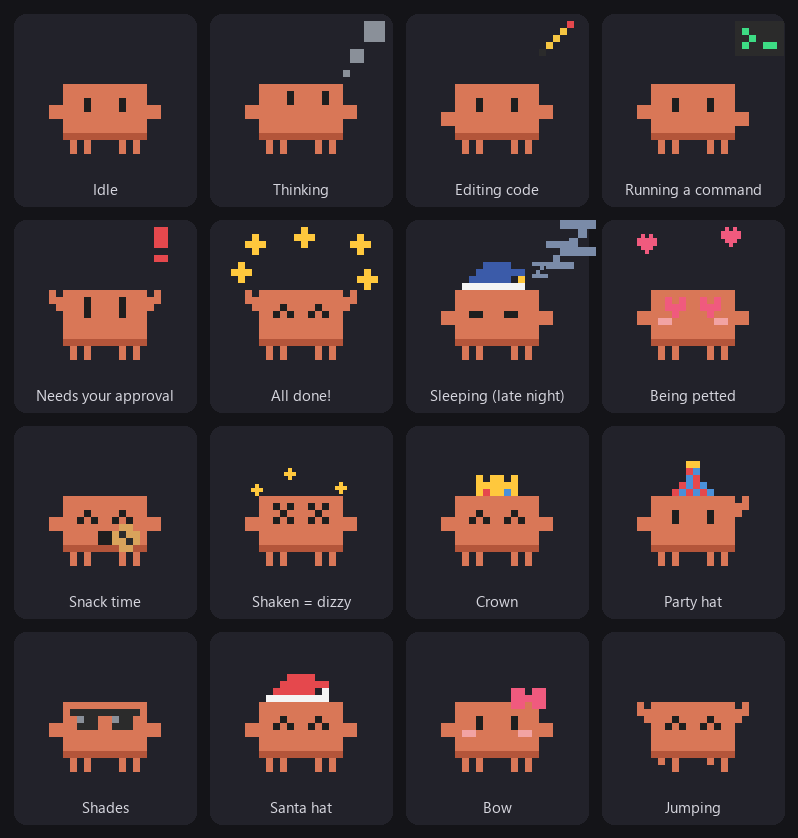

# Claude Pet for Windows

A little pixel Claude that lives on your Windows desktop and reacts to what
[Claude Code](https://claude.com/claude-code) is doing in real time. It reads,
types, waits for your approval, celebrates when work is done, and hops around
on your windows, desktop icons and app toolbars while Claude is idle.

[中文说明](#中文说明)



## Install

You need Windows 10 or 11, [Python](https://www.python.org/downloads/) 3.8+
(the standard installer, which includes tkinter) and Claude Code.
[Pillow](https://pypi.org/project/pillow/) is optional; it's used to detect
edges inside apps (`py -m pip install pillow`).

```bat
git clone https://github.com/REXG114514/claude-pet-windows.git
cd claude-pet-windows
install.bat
```

`install.bat` copies the pet to `%LOCALAPPDATA%\ClaudePet`, adds hooks to
`~/.claude/settings.json` (your existing settings and hooks are kept, and a
backup is saved as `settings.json.bak-claude-pet`), adds a Start menu
shortcut and starts the pet. From then on, **the pet starts automatically
whenever a Claude Code session starts**.

To uninstall, run `uninstall.bat` (or `%LOCALAPPDATA%\ClaudePet\uninstall.bat`).
Your stats stay in `~/.claude-pet`; add `--purge` to delete them too.

Want a look first? Run `py pet.py --demo` to cycle through every state.

## What it does

| Claude Code is… | The pet… |
|---|---|
| starting a session | waves hello |
| thinking | looks up, thought bubbles |
| reading / searching | eyes scan left and right, magnifier |
| editing files | types with both hands, pencil |
| running commands | types, terminal icon |
| browsing the web | globe icon |
| running a sub-agent | tiny Claude icon |
| waiting for your permission | jumps with arms up, red “!”, the bubble stays until you answer (optional beep) |
| done | cheers and jumps with sparkles (confetti if it worked for more than 2 minutes) |
| compacting context | squishes with eyes closed |
| idle for 3 minutes | falls asleep, Zzz |

With several sessions open, it shows the most urgent one and prefixes the bubble with the project name.
Hover over it to see what it's doing plus today's prompts, tool calls, streak and affection.

## Playing with it

| You… | It… |
|---|---|
| move the mouse | follows the cursor with its eyes and waves when you come close |
| click | blushes, heart |
| rub the mouse back and forth over it | heart eyes, purrs, floating hearts |
| double-click | eats a cookie (up to 5 an hour) |
| shake it while dragging | gets dizzy, stars circling its head |
| drop it in mid-air | falls onto whatever is below, with a puff of dust |
| leave it alone | walks, jumps around, stretches, yawns, dances, sits |

- **Hopping around:** while Claude is idle it walks and jumps onto window tops, desktop icons, any horizontal
  edge visible inside apps (toolbars, panels, separators, input boxes) and the taskbar. It rides along when
  you drag the window it stands on, falls when that window closes or the edge scrolls away, and jumps onto a
  window that covers it.
- **Outfits:** party hat, bow, shades, crown, Santa hat. Automatic Santa hat at Christmas and a nightcap after 11pm.
- **Affection:** petting, rubbing, feeding and saying hi each day raise it, from “Stranger” to “Soulmate”.
- **Milestones:** confetti for your 10th/30th/50th/100th… prompt of the day and 3/7/30… day streaks.
- **Reminders:** a greeting for the time of day, lunch and dinner reminders, bedtime nudges, and a stretch
  reminder after an hour of coding.

Right-click for everything else: feed, tricks, outfit, size, language, wander, gravity, jumping, edge
detection, progress bubbles, approval beep, always on top, start with Windows, demo mode and quit.

## Language

The pet speaks Chinese and English. By default it follows Claude Code's `language` setting, then the Claude
desktop app's language, then the Windows display language. You can pick one from the right-click menu.

## How it works

- `claude_pet_hook.py` is registered for the Claude Code hook events `SessionStart`, `UserPromptSubmit`,
  `PreToolUse`, `PostToolUse`, `Notification`, `Stop`, `PreCompact` and `SessionEnd`. Each event writes a
  small state file to `~/.claude-pet/sessions/` (and starts the pet if it isn't running). It takes about
  0.1 s per call.
- `pet.py` is a transparent, always-on-top tkinter window that polls those files and animates. Stats are
  stored in `~/.claude-pet/stats/`, settings in `~/.claude-pet/config.json`.
- `platforms.py` finds places to stand: top-level windows (with what covers them), desktop icon positions
  from Explorer's list view, and long horizontal edges found by a simple edge detector on a screenshot of the
  area around the pet. Screenshots stay in memory and are never saved or sent anywhere.
- `i18n.py` holds all the text and the language detection.

Notes:

- Reading desktop icon positions means asking Explorer's list view, which can only answer into a small buffer
  inside Explorer's memory. This is the usual technique for desktop tools, but some security software may
  notice it. Turn off “Jump onto windows & icons” if you prefer.
- It only roams while Claude is idle, and stops while the mouse is over it.

## License

[MIT](LICENSE)

---

## 中文说明

一只住在 Windows 桌面上的像素小 Claude，实时反映 [Claude Code](https://claude.com/claude-code) 在做什么：读文件、敲代码、
等你批准、完成时欢呼，Claude 空闲时还会在窗口、桌面图标和软件的工具栏上跳来跳去。

### 安装

需要 Windows 10/11、[Python](https://www.python.org/downloads/) 3.8+（官方安装包自带 tkinter）和 Claude Code。
[Pillow](https://pypi.org/project/pillow/) 可选，用来识别软件里的边界（`py -m pip install pillow`）。

```bat
git clone https://github.com/REXG114514/claude-pet-windows.git
cd claude-pet-windows
install.bat
```

`install.bat` 会把程序复制到 `%LOCALAPPDATA%\ClaudePet`，在 `~/.claude/settings.json` 里加入 hooks（保留你原有的设置和 hooks，
并备份为 `settings.json.bak-claude-pet`），创建开始菜单快捷方式并启动桌宠。之后**每次启动 Claude Code 会话，桌宠都会自动跟着启动**。

卸载：运行 `uninstall.bat`（或 `%LOCALAPPDATA%\ClaudePet\uninstall.bat`）。统计数据保留在 `~/.claude-pet`，加 `--purge` 一起删除。

想先看看效果：`py pet.py --demo` 会把所有状态轮播一遍。

### 它会做什么

| Claude Code 在… | 桌宠 |
|---|---|
| 刚开会话 | 挥手打招呼 |
| 思考 | 眼睛往上看，冒思考泡泡 |
| 读文件 / 搜索 | 眼睛左右扫，放大镜 |
| 改文件 | 双手敲键盘，铅笔 |
| 跑命令 | 敲键盘，终端图标 |
| 上网 | 地球图标 |
| 派子代理 | 小 Claude 图标 |
| 等你批准权限 | 举手跳、红色感叹号，气泡一直显示到你处理（可开提示音） |
| 完成 | 欢呼跳跃 + 星星（忙了 2 分钟以上会撒彩带） |
| 压缩上下文 | 闭眼压扁 |
| 3 分钟没动静 | 睡觉 Zzz |

同时开多个会话时显示最紧急的那个，气泡前面带项目名。鼠标悬停可以看到当前状态、今日提问数、工具调用数、连续天数和亲密度。

### 跟它玩

| 你做… | 它会… |
|---|---|
| 移动鼠标 | 眼睛跟着鼠标转，鼠标靠近时挥手 |
| 单击 | 害羞脸红冒爱心 |
| 在它身上来回晃鼠标（撸） | 爱心眼、呼噜呼噜、飘爱心 |
| 双击 | 吃饼干（一小时最多 5 块） |
| 拖着它左右猛甩 | 转晕，星星绕头 |
| 拖到半空松手 | 掉到下面最近能站的地方，落地扬灰 |
| 不理它 | 自己溜达、跳来跳去、伸懒腰、打哈欠、跳舞、坐下 |

- **到处跳**：Claude 空闲时，它会走动并跳上窗口顶边、桌面图标、软件里任何水平边界（工具栏、面板、分隔线、输入框）和任务栏。
  你拖动它脚下的窗口它会一起移动；窗口关闭或边界滚走时会掉下去；被窗口盖住时会跳到那个窗口顶上。
- **装扮**：派对帽、蝴蝶结、墨镜、皇冠、圣诞帽。圣诞节自动戴圣诞帽，晚上 11 点后自动戴睡帽。
- **亲密度**：摸摸、撸撸、喂零食、每天第一次见面都会涨，从“刚认识”到“灵魂伴侣”。
- **里程碑**：当天第 10/30/50/100… 次提问、连续 3/7/30… 天都会撒彩带。
- **贴心提醒**：按时间问好，提醒吃午饭晚饭、早点睡觉，连续写代码一小时提醒起来活动。

其他设置都在右键菜单：喂零食、表演、装扮、大小、语言、溜达、重力、跳跃、边界识别、进度气泡、批准提示音、总在最前、开机自启、演示模式、退出。

### 语言

支持中文和英文。默认依次跟随 Claude Code 的 `language` 设置、Claude 桌面版的界面语言、Windows 显示语言，也可以在右键菜单里手动选择。

### 原理

- `claude_pet_hook.py` 注册在 Claude Code 的 hook 事件上，每个事件写一个小状态文件到 `~/.claude-pet/sessions/`（桌宠没在运行时顺便启动它），每次大约 0.1 秒。
- `pet.py` 是一个透明、置顶的 tkinter 窗口，读取状态文件并播放动画。统计在 `~/.claude-pet/stats/`，设置在 `~/.claude-pet/config.json`。
- `platforms.py` 负责找能站的地方：顶层窗口（以及谁挡住了谁）、从资源管理器读取的桌面图标位置，以及对桌宠周围截图做边缘检测找到的长水平线。截图只在内存里分析，不保存也不上传。
- `i18n.py` 存放所有文字和语言识别逻辑。

注意：

- 读取桌面图标位置需要在资源管理器进程里开一块很小的缓冲区来接收结果，这是桌面工具的常规做法，但有些安全软件可能会提示。介意的话可以在右键菜单关掉“跳上窗口和桌面图标”。
- 它只在 Claude 空闲时到处跑，鼠标停在它身上时会停下来。

### 许可证

[MIT](LICENSE)
